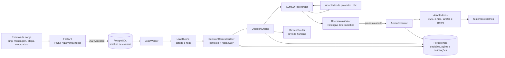

# Freight Load SOP Agent

Agente orientado a eventos para acompanhar cargas e interpretar procedimentos
operacionais (SOP). A aplicação combina atualizações determinísticas do estado
da carga com propostas de decisão de um LLM; regras locais validam cada proposta
antes de qualquer ação externa.

## Arquitetura



O `LoadWorker` e o fluxo de decisão são componentes do projeto; a inicialização
da API **não** inicia o worker automaticamente. A API persiste os eventos para
processamento separado.

## Executar os evals

Requer Python 3.11 ou superior. Na raiz do projeto, instale as dependências de
teste uma vez:

```bash
python -m pip install -e ".[test]"
```

Execute todos os evals com um comando:

```bash
python -m pytest -q tests/evals
```

Os cenários em [`tests/evals/scenarios.json`](tests/evals/scenarios.json)
verificam decisões com ação, sem ação, abstenção e citação SOP inválida. A
avaliação é local e determinística: não requer banco de dados, credenciais ou
chamada a um LLM real.

## Estrutura do projeto

- [`src/app/agent/`](src/app/agent/): processamento de eventos, estado da carga
  e orquestração de decisões.
- [`src/app/rules/`](src/app/rules/): seleção de regras SOP e validação das
  propostas.
- [`src/app/services/`](src/app/services/): interpretação SOP, execução de
  ações e serviços de documentos.
- [`src/app/memory/`](src/app/memory/): repositórios e persistência PostgreSQL.
- [`src/adapters/`](src/adapters/): integrações com provedores LLM e sistemas
  externos.
- [`src/models/`](src/models/): modelos de domínio e contratos tipados.
- [`tests/`](tests/): testes unitários, de integração, de contrato e evals.
- [`migrations/`](migrations/): schema do banco de dados.
