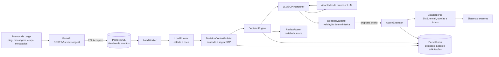

# Freight Load SOP Agent

Agente orientado a eventos para acompanhar cargas e interpretar procedimentos
operacionais (SOP). A aplicação combina atualizações determinísticas do estado
da carga com propostas de decisão de um LLM; regras locais validam cada proposta
antes de qualquer ação externa.

## Arquitetura



O `LoadWorker` e o fluxo de decisão são componentes do projeto; a inicialização
da API **não** inicia o worker automaticamente. A API persiste os eventos para
processamento separado.

## Demonstração local ou no Render

O worker pode ser executado separadamente da API. A primeira versão executável
usa decisões determinísticas de demonstração: não chama um LLM real, e os
adaptadores não enviam mensagens nem criam tarefas/timers externos. Os
resultados ficam registrados como decisões `demo` e eventuais ações simuladas;
não representam uma operação de produção.

Depois de instalar o projeto e aplicar `migrations/001_initial_schema.sql` e
`migrations/002_worker_claim_recovery.sql`, configure `FREIGHT_DATABASE_URL`
para um banco **dedicado à demonstração**. Carregue os dados de exemplo e
inicie o worker:

```bash
FREIGHT_ENVIRONMENT=demo python -m workers.seed_demo_data
python -m workers.run_worker
```

Execute a API em outro terminal apontando para o mesmo banco:

```bash
uvicorn app.api:app --app-dir src --host 127.0.0.1 --port 8000
```

Envie um evento `ping` para `broker_id=demo_broker` e `load_id=demo_load` em
`/v1/events/ingest`. O evento deve passar para `completed` e a decisão
determinística ficará registrada no PostgreSQL. No Render, mantenha a API como
Web Service e configure um **Background Worker** separado com o start command
`python -m workers.run_worker`; ambos usam o mesmo segredo
`FREIGHT_DATABASE_URL`. O seeder exige `FREIGHT_ENVIRONMENT=demo` e recusa
registros conflitantes. Não execute o worker de demonstração sobre dados de
produção.

Consulte [`specs/002-runnable-worker/quickstart.md`](specs/002-runnable-worker/quickstart.md)
para os comandos de migração, teste e inspeção do resultado.

## Executar os evals

Requer Python 3.11 ou superior. Na raiz do projeto, instale as dependências de
teste uma vez:

```bash
python -m pip install -e ".[test]"
```

Execute todos os evals com um comando:

```bash
python -m pytest -q tests/evals
```

Os cenários em [`tests/evals/scenarios.json`](tests/evals/scenarios.json)
verificam decisões com ação, sem ação, abstenção e citação SOP inválida. A
avaliação é local e determinística: não requer banco de dados, credenciais ou
chamada a um LLM real.

## Estrutura do projeto

- [`src/app/agent/`](src/app/agent/): processamento de eventos, estado da carga
  e orquestração de decisões.
- [`src/app/rules/`](src/app/rules/): seleção de regras SOP e validação das
  propostas.
- [`src/app/services/`](src/app/services/): interpretação SOP, execução de
  ações e serviços de documentos.
- [`src/app/memory/`](src/app/memory/): repositórios e persistência PostgreSQL.
- [`src/adapters/`](src/adapters/): integrações com provedores LLM e sistemas
  externos.
- [`src/models/`](src/models/): modelos de domínio e contratos tipados.
- [`tests/`](tests/): testes unitários, de integração, de contrato e evals.
- [`migrations/`](migrations/): schema do banco de dados.
